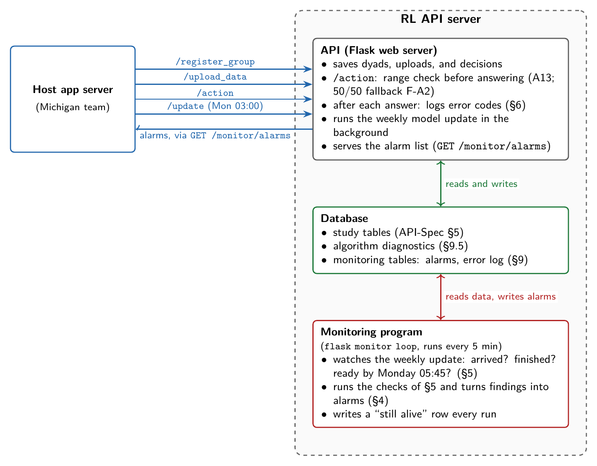

# ADAPTS-HCT RL API — Monitoring Specification

> **Status: draft for review, 2026-10-11.** This document is meant to replace
> `Overleaf/Monitoring_Algorithm/monitoring.tex` (2026-08-03),
> `Overleaf/Monitoring_Algorithm/monitoring_items.tex` (2026-08-12),
> `Algorithm-Monitoring.md`, and `Monitoring_Algorithm/PLAN.md`. It agrees
> with `API-Spec.md` (what the host's app server can call) and
> `Hyperparameters.md` (settings). It also replaces `ERROR_CODE.md`: the
> full list of API answers and error codes is now §6. Questions that still need a decision are
> listed in §12; each is also marked **[open #n]** where it comes up.

> "The algorithm" always means the deployed RL algorithm. Where a check
> depends on a detail of the algorithm, the detail is stated in the check.

The design in five points:

1. **Monitoring runs on the RL API server and is part of the API code.** Most
   of it is a separate program that wakes up every 5 minutes, reads the API
   database, and runs its checks. A few small checks run inside the API
   itself, at the moment a request is handled; they are written so that they
   can never make a request fail.
2. **It does four jobs.** It watches the weekly model update (the host's app
   server calls `/update`; monitoring checks that the call arrived, that the
   fit finished, and that everything was ready before the week's first
   decision). It runs a fixed list of checks. It keeps a record of every
   problem for the post-trial analysis. And it hands the resulting alarms to
   the host's app server.
3. **The host's app server gets alarms by calling an API endpoint.** It calls
   `GET /api/v1/monitor/alarms` (`API-Spec.md` §2.5) and receives every alarm.
   That call is the only way alarms leave the RL side: monitoring sends no
   email and pushes nothing. Getting an alarm in front of a person is the
   host's job (its dashboard and alerts, `References/Dashboard_Monitoring.md`).
4. **Severity follows [Trella et al. (2026)](https://doi.org/10.1038/s41746-026-02669-4): red, yellow, green.** Where a
   problem has a safe automatic response (a "fallback", §7), that response is
   written down in advance and is part of the deployed algorithm.
5. **Every check works only from what is saved in the database.** So any
   check can be run again later, over any past period, and maintain the reproducibility.

---

## 1. Scope

### 1.1 The question monitoring answers

*Is the deployed algorithm doing what the design documents say it should?*
Monitoring does **not** ask whether the algorithm is a good one.

We keep the three pillars of [Trella et al. (2026), *npj Digital Medicine*](https://doi.org/10.1038/s41746-026-02669-4),
developed for Oralytics and MiWaves:

1. list the possible problems, each with a severity;
2. decide in advance what happens automatically when a problem occurs, so
   participants are protected right away;
3. record every problem in enough detail for the post-trial analysis.

### 1.2 Relationship to other documents

| Document | What it is | How this document uses it |
|---|---|---|
| `API-Spec.md` | the host–API contract | `/monitor/alarms` (§2.5) and two monitoring tables (§5.10–5.11) are defined there; §8.1 below proposes additions |
| `Hyperparameters.md` | algorithm settings | check C9 verifies that the approved settings are in use; §10 here holds monitoring's own settings |

---

## 2. How it is built



*Source: [`figures/monitoring_architecture.tex`](figures/monitoring_architecture.tex) (TikZ; rebuild with `pdflatex` then `pdftoppm -png -r 220 -singlefile`).*

### 2.1 Where checks run

| Where | When it runs | Can it stop anything? | Examples |
|---|---|---|---|
| **Inside `/action`** | after the decision is computed, before the answer is sent | yes: if the probability is impossible, it replaces the decision with a safe 50/50 one (F-A2); the call still succeeds | A13 |
| **After each API response** | right after the API answers any call | no | logging every error response (§6) |
| **Before an update is published** | inside the weekly update, before new model parameters are used | yes: bad parameters are not used, and last week's stay in force (F-U2) | C3 |
| **In the monitoring program** | on a schedule (every 5 min, daily, or weekly; listed per check in §5) | no | everything else |

### 2.2 Rules all checks follow

- **Never break an API call.** If a check itself crashes, the error is caught
  and recorded as problem E7; the API call goes through normally.
- **Work only from saved data.** A scheduled check looks only at what is in
  the database for the time period it is given, so running it again later
  gives the same result. For values the API overwrites (a dyad's consent
  dates), it reads the value as it was at that time from `group_history`
  (§9.6). For server load (E1), it reads the measurements monitoring saved
  at each run.
- **No participant data in alarms.** Alarms and the error log contain only
  coded IDs (`group_id`, `decision_type`, `decision_idx`, `rid`), numbers, and
  thresholds. Request bodies are not stored, only a fingerprint (SHA-256) of
  each, to tell identical requests apart.

### 2.3 Why the monitoring program runs separately from the API

The API must answer quickly at decision times, and a crash in either program
must not take the other down. The monitoring program is restarted
automatically if it stops (by systemd or supervisord), and it writes a
"still alive" row every time it runs. If it does die, that shows up three
ways:

1. the `monitor_last_tick` time in every `/monitor/alarms` answer stops
   advancing (§8.1);
2. the daily green status alarm G0 does not appear (§5.G);
3. when it restarts, it records how long it was down (E5).

---

## 3. Terms used in this document

| Term | Meaning |
|---|---|
| **Study timezone** | one timezone for the whole trial (setting `MONITOR_STUDY_TZ`, §10). All days and weeks below use it. |
| **Study week w** | Monday 00:00 to Sunday 24:00. A dyad's first study week starts on its `consent_start_date`, which is a Monday (`API-Spec.md` §2.1). |
| **enr_i** | dyad i's `consent_start_date`, the Monday of its week 1 |
| **E_w, I_w** | E_w = dyads enrolled by week w; I_w = dyads still in their 14 trial weeks in week w |
| **Active dyad on day d** | in I_w for that week, and day d is within its consent dates |
| **Decision calendar** | how many `/action` calls each active dyad should get per day, per agent (setting `MONITOR_DECISION_CALENDAR`). **[open #1]** API-Spec §3 has decisions Monday–Saturday (AYA 2/day, CP 1/day, REL on Mondays); the algorithm assumes them every day (AYA 14/week, CP 7/week). n_week^g is the number of decisions per week for agent g. |
| **π** | the probability of sending (action = 1) for a decision, stored as `actions.action_prob` (`API-Spec.md` §2.2) |
| **Warm-up decision** | a decision made by a 50/50 coin flip instead of the learned policy (`actions.is_warmup = true`). Reasons: `cohort` (fewer than 5 dyads enrolled), `week1` (the dyad's first week), `no_policy` (no learned policy available for this dyad), `fallback:<cause>` (§7) |
| **Week-closing upload** | the one `/upload_data` per dyad, sent between Sunday midnight and the Monday update, that carries the final outcomes of the week that just ended (`API-Spec.md` §2.3) |
| **Week-w update** | the `/update` call the host's app server makes at Monday 03:00 of week w; it produces the policies used during week w |
| **Policy version (g, w)** | agent g's posteriors produced by the week-w update. Every learned decision records which version it used. |
| **Week w is ready** | the week-w update finished; each agent either published its new policy (passed C3) or kept last week's (F-U2); and, once learning has started (at least 5 dyads enrolled), the week's REL game action has been drawn for every dyad in the trial. During the cohort warm-up, the update only computes rewards and baselines; it fits nothing and draws no game actions. |
| **L_min, L_max** | the lowest and highest allowed π, 0.2 and 0.8 by default (`Hyperparameters.md` §3.4) |

---

## 4. Severity, ownership, and how alarms behave

### 4.1 Severity

| Severity | Meaning | Examples | Expected response |
|---|---|---|---|
| **Red** | harms the participant's experience, or the scientific value of the trial data | a learned π used during a dyad's first week; a recorded action that does not match its coin flip | appears in the alarm list within 5 minutes; the host alerts its on-call person and the RL team; fixed the same day, with a written note on what happened |
| **Yellow** | stops the algorithm from learning or acting correctly, because of a technical (not statistical) failure | the empirical-Bayes optimizer did not converge; week-closing uploads missing; the week's update not ready at 05:45 Monday | appears in the alarm list; looked at within one working day |
| **Green** | needs no fix, but must be recorded so the analysis is valid | a variance hitting its floor; a change in how often data are missing; a slow update | appears in the alarm list; kept in the problem log and in `flask monitor report` for the data analyst |

Following [Trella et al.](https://doi.org/10.1038/s41746-026-02669-4), an automatic response that protects the participant
can lower a problem's severity by one level. Where §5 keeps a problem red
despite such a response, it says why.

### 4.2 Owner

Every check names an **owner**, the team that has to fix the problem:

- `rl`: the RL team fixes it on the server or in the algorithm;
- `host`: the host team fixes its scheduling, uploads, or registration.

The host decides who gets alerted, using severity and owner. 


---

## 5. The checks

How to read the tables:

- **Sev.**: severity of the alarm (where a continuing problem raises a red
  alarm instead of a yellow one, the description says so).
- **Owner**: `rl` or `host` (§4.2).
- **Runs**: where and how often the check runs (§2.1).
- **Fallback**: the automatic response of §7, or `—` if there is none.

Each table has two kinds of rows:

1. **Checks that monitoring runs** (IDs such as A4 or C7). IDs are kept from
   `monitoring.tex` wherever the check still exists, so older notes stay
   readable; Appendix A maps every old ID. **new** marks a check with no
   earlier version; **rev** marks one whose definition changed.
2. **Errors the endpoint returns** (IDs are error codes such as
   `AC-400-PARAM`). They are recorded right after the API answers (§6), so no
   check repeats them. The exact answers behind each code are in §6.

### 5.A Decisions (`/action`)

| ID | Sev. | Owner | What it checks | Runs | Fallback |
|---|---|---|---|---|---|
| **A13** new | red | rl | **π out of range.** A learned decision has π below L_min, above L_max, or not a number; or a warm-up decision has π other than 0.5. The design makes both impossible, so any detection means a bug in the algorithm. It stays red even though F-A2 protects the participant, because one bad π suggests the algorithm may be wrong for every dyad. | inside `/action`; inside the update for REL actions drawn there | F-A2 |
| **A4** rev | red | rl | **Each decision can be reproduced.** Every night, redo yesterday's decisions from saved data and compare: (1) for each learned decision, recompute π from the saved policy (α^EB, Σ^EB), the saved state f(s), and the fixed set of random draws used to compute π; it must match the recorded π to within 1e-12; (2) for every decision, recompute the action from its saved random number (A = 1 if u < π); it must match the recorded action, and each decision must have used exactly one random number. Fires on any mismatch. | nightly, for all of yesterday's decisions | — |
| **A10** rev | red | rl | **Warm-up follows the algorithm's rules.** Every night, for each of yesterday's decisions, work out from saved data whether it *should* have been a coin flip, and compare with what was recorded (`is_warmup`, `warmup_reason`). Should be a coin flip if: (a) fewer than N_warm dyads had a `consent_start_date` on or before that study week's Monday (cohort rule; dates from `group_history`), or (b) the decision falls in the dyad's own first study week (first-week rule). Otherwise it should use the learned policy. **Red:** a decision that should have been a coin flip used a learned π. That breaks the coin-flip weeks that the baselines and σ̂² depend on. Coin flips with reason `no_policy` (no policy published for the dyad) are reported by B5. Coin flips with reason `fallback:*` are not counted here; they are reported by `AC-201-FALLBACK`. | nightly, for all of yesterday's decisions | — |
| **A6** | red | host | **Too many messages.** The number of messages the host delivered to the dyad in its study week is above the cap K^g. Counted from the host's uploads (`/upload_data`). | weekly, Monday | — **[open #4]** |
| **A7** | red | host | **Too few messages.** The number of messages the host delivered to the dyad in its study week is below the floor L^g. Same upload data as A6. | weekly, Monday | — **[open #4]** |
| **A2** rev | yellow | host | **Number of calls per day**. For each active dyad, agent, and day: the number of `/action` calls differs from the decision calendar, or a call came on a day with no scheduled decisions. A missing call may be a decision the host made with its own coin flip (F-A1); the API cannot tell the two apart. A REL decision counts once, whether it was drawn at the update or by `/action` **[open #13]**. | daily 07:00, for the previous day | F-A1 |
| **A8** | yellow | host | **Outside the consent dates.** `/action` for a dyad before its `consent_start_date` or after its `consent_end_date`. For now the decision is still made and the call is flagged. **[open #6]** | after each `/action` | — |
| **A15** new | yellow | host | **Game status does not match.** A learned AYA or CP decision in week w used a game on/off value (`current_game_on`) different from the REL game action the API drew for that week. Means the host sent an out-of-date value, or the state was built from the wrong week. | after each `/action` | — |
| **A5** rev | yellow | rl | **The whole cohort is at the limit.** On 7 days in a row, at least 80% of an agent's active dyads with learned decisions (and at least 5 such dyads) have π within 0.01 of L_min or L_max. The design allows a dyad's π to reach the limit; the whole cohort doing so early in the trial is worth a look at the posteriors. **[open #5]** | daily | — |
| `AC-201-FALLBACK` | yellow | rl | **50/50 fallback used inside `/action`.** The state could not be built or the algorithm crashed, so `/action` answered with a coin flip (reason in `detail`). An impossible π is reported as A13 instead. Applies once F-A2 is built. *Host:* nothing; the decision is valid. | when the endpoint returns it | F-A2 |
| `AC-400-PARAM` | red | host | **Decision request rejected.** A request field is missing or invalid. *Host:* flip your own coin; fix the call. | when the endpoint returns it | F-A1 |
| `AC-404-GROUP` | red | host | **Decision for an unregistered dyad.** *Host:* flip your own coin; register the dyad before its next decision. | when the endpoint returns it | F-A1 |
| `AC-409-NOSTATE` | red | host | **Decision before any upload.** The dyad has sent no upload yet **[open #12]**. *Host:* flip your own coin; send an upload. | when the endpoint returns it | F-A1 |
| `AC-500-STATE` | red | rl | **State could not be built.** From the dyad's latest upload. Becomes `AC-201-FALLBACK` once F-A2 is built. *Host:* flip your own coin. | when the endpoint returns it | F-A1 |
| `AC-500-PERSIST` | red | rl | **Decision could not be saved.** It failed after its random number was used, so the decision can no longer be recomputed exactly. *Host:* flip your own coin. | when the endpoint returns it | F-A1 |
| `AC-500-LEARNER` | red | rl | **Algorithm crashed.** Any other algorithm error, including the random-number file being unavailable. Becomes `AC-201-FALLBACK` once F-A2 is built. *Host:* flip your own coin. | when the endpoint returns it | F-A1 |
| `AC-503-MODEL` | red | rl | **Algorithm not loaded.** A deployment problem the host cannot fix. *Host:* flip your own coin. | when the endpoint returns it | F-A1 |


### 5.B Registration, uploads, and rewards (`/register_group`, `/upload_data`)

| ID | Sev. | Owner | What it checks | Runs | Fallback |
|---|---|---|---|---|---|
| **B11** new | yellow | host | **Week-closing upload missing.** When the Monday `/update` arrives, a dyad that was active last week has no upload since Sunday midnight. Its last outcomes of the week are then used one week late. Red if the same dyad misses two weeks in a row. | when the update arrives | — |
| **B5** rev | yellow | rl | **Dyad has no policy this week.** At each update, a dyad past its first week gets no posterior for an agent, so its decisions that week are coin flips (F-A3). The usual cause is a missing standardization baseline: an AYA or CP value that should be standardized (AYA: app burden; CP: app burden and missing rate) has none, or REL's population baselines are missing; the cause is in `detail`. Also records, green, values left unstandardized because they were constant during week 1 (standard deviation below 1e-3). | each weekly update | F-A3 |
| **B8** rev | yellow | host | **Upload missing before a decision.** A decision made by `/action` had no upload from the same dyad in the 30 minutes before it; or a dyad sent more than one week-closing upload in a week. A REL decision drawn at the update is matched to the dyad's week-closing upload instead (if that is missing, B11 fires). | daily | — |
| **B3** | green | host | **Missing-data rate changed.** For any upload field, the share of uploads marked `"miss"` changed by more than 0.15 compared with the previous 7 days. | daily | — |
| `RG-400-PARAM` | yellow | host | **Registration rejected.** A field is missing, a date cannot be read, or `consent_start_date` is not a Monday (every study week runs Monday–Sunday). *Host:* correct it and send again. | when the endpoint returns it | — |
| `RG-409-MEMBER` | red | host | **Registration with different members.** The dyad was registered before with other members. *Host:* do not retry; escalate to the RL team. | when the endpoint returns it | — |
| `RG-500-INTERNAL` | yellow | rl | **Registration failed: server error.** *Host:* retry (registering again is safe); escalate if it keeps happening. | when the endpoint returns it | — |
| `RG-503-DB` | yellow | rl | **Registration not saved.** Database write failed. *Host:* retry later. | when the endpoint returns it | — |
| `UD-400-PARAM` | yellow | host | **Upload rejected: request fields.** `group_id`, `timestamp`, or `data` is missing or of the wrong type. *Host:* correct it and send again. | when the endpoint returns it | F-U1 |
| `UD-400-UNKNOWN` | yellow | host | **Upload rejected: unknown field.** A field not listed in `API-Spec.md` §4.1. *Host:* correct it and send again. | when the endpoint returns it | F-U1 |
| `UD-400-MISSINGFIELD` | yellow | host | **Upload rejected: field missing.** A field from `API-Spec.md` §4.1 is missing. *Host:* send `"miss"` instead of leaving it out. | when the endpoint returns it | F-U1 |
| `UD-400-TYPE` | yellow | host | **Upload rejected: wrong type.** A value has the wrong type. *Host:* correct it and send again. | when the endpoint returns it | F-U1 |
| `UD-400-RANGE` | yellow | host | **Upload rejected: value out of range.** A value is outside the range `API-Spec.md` §4.1 allows, e.g. a diary or relationship item outside 1–5 **[open #14]**. Checking this at upload keeps every reward within its definition (AYA 0 or 3; CP 0 or 1–5; REL 0 to 5 + 3·w_adh). *Host:* correct it and send again. | when the endpoint returns it | F-U1 |
| `UD-400-INCONSISTENT` | yellow | host | **Upload rejected: values do not fit together.** `week_in_study` does not match `day_in_study` (week = ⌊(day − 1)/7⌋ + 1); `day_in_study` does not match the dyad's consent start date and the upload's date; or `slot` (am/pm) does not match the upload's time of day. *Host:* correct it and send again. | when the endpoint returns it | F-U1 |
| `UD-404-GROUP` | yellow | host | **Upload for an unregistered dyad.** *Host:* register the dyad, then send again. | when the endpoint returns it | — |
| `UD-500-INTERNAL` | yellow | rl | **Upload failed: server error.** *Host:* retry (sending an upload twice is harmless). | when the endpoint returns it | — |
| `UD-503-DB` | yellow | rl | **Upload not saved.** Database write failed. *Host:* retry. | when the endpoint returns it | — |

### 5.C The weekly update (`/update`)

The host's app server calls `/update` every Monday at 03:00, after the
week-closing uploads; the full Monday schedule is in `API-Spec.md` §3.

| ID | Sev. | Owner | What it checks | Runs | Fallback |
|---|---|---|---|---|---|
| **C7** rev | yellow | rl | **Week not ready at 05:45.** At Monday 05:45 the week is not ready (§3). `detail` says why: the update never arrived (see also C11), is still running or got stuck (still running after 30 minutes, it is marked failed so the host can safely send `/update` again, F-U4), failed, has not published all three agents, or a REL game action for the week is missing. Decisions still go out on last week's policy (F-U2), with the policy used recorded on each decision, so no data are lost; the week simply learns less. | Monday 05:45 | F-U2 |
| **C11** new | red | host | **Update never arrived.** No `/update` call for the week has arrived by Monday 03:30, so the host's weekly trigger did not run. | Monday 03:30 | — |
| **C9** new | red | rl | **Unapproved settings used.** After the settings are frozen, a fit or a decision has no settings fingerprint (hash) recorded, or one that does not match the approved version in force at that time (`hyperparameter_sets`); or the API refused to start because the settings file differs from the frozen set (the start-up check records this before stopping; `Hyperparameters.md` §2.3). | after each decision, at each update, and at start-up | — |
| **C3** rev | yellow | rl | **Validity of model parameters.** This is the only check allowed to stop the algorithm's output. For each agent, before its new policy is used (for REL, before the week's game actions are drawn), all of the following must hold; otherwise that agent's new policy is not used and last week's stays in force (F-U2). (1) Every fitted number is finite: θ̂_{i,w}, Σ̂_{i,w}, Θ̂_w, τ̂²_w, α^EB_{i,w}, Σ^EB_{i,w}. (2) Σ̂_{i,w} and Σ^EB_{i,w} are valid variance matrices: symmetric, with no eigenvalue below −1e-10 × their trace. (3) Each between-dyad variance is at or above its floor: τ̂²_{w,b} ≥ (1 − 1e-6) × floor_b. (4) Pooling did not increase any variance: the smallest eigenvalue of Σ̂^αα_{i,w} − Σ^EB_{i,w} and of Σ̂_{0,w} − Σ^EB_{i,w} is at least −(ε + 1e-10 × trace), where ε is the numerical ridge of `Hyperparameters.md` §4 (the ridge can add at most ε). (5) The number of parameters matches the design: AYA 9 baseline + 4 effect coefficients, CP 8 + 4, REL 8 + 3. Becomes red if the check fails two weeks in a row for the same agent. | inside the update | F-U2 |
| **C1** rev | yellow | rl | **Update failed or fell back.** Either the update ended with an error, for any reason other than C3 (which reports itself), or the empirical-Bayes optimizer for the between-dyad parameters returned a non-finite value or hit its iteration limit K_max without converging, so last week's (Θ̂, Σ̂₀) were reused (F-U5). `detail` says which, and for which agent. Red after two weeks in a row for the same agent. How often the optimizer falls back over the trial is reported in G0 and `flask monitor report`. | every 5 min; after each update | F-U2, F-U5 |
| **C5** rev | yellow | rl | **Update can be rerun exactly**. Rerun the week's update from its saved copy of the data and the same random numbers. Every published result (θ̂, Σ̂, Θ̂, τ̂², α^EB, Σ^EB) must come out identical. (Each decision is reproduced separately by A4.) Red after two weeks in a row. | weekly, Tuesday 02:00 | — |
| **C10** new | yellow / green | rl | **Noise scale set.** Runs once, at the first learning update. Green: records, per agent, the number of week-1 rewards used, their variance s², the upper limit σ̄², the chosen σ̂², and the resulting τ²₀ values. Yellow: the upper limit was used, either because the variance exceeded it or because there were fewer than two week-1 rewards. | after the first learning update | — |
| `UP-400-PARAM` | yellow | host | **Update request rejected.** `timestamp` is missing. *Host:* fix the weekly update call. | when the endpoint returns it | — |
| `UP-503-ENQUEUE` | red | host | **Update could not be started.** Nothing was recorded. *Host:* send `/update` again; do not wait on the returned `rid`. | when the endpoint returns it | — |

### 5.L Model diagnostics (weekly, for the record)

| ID | Sev. | Owner | What it checks | Runs |
|---|---|---|---|---|
| **L1** new | green | rl | **Variance at its floor.** A between-dyad variance τ̂²_{w,b} within 1% of its floor, per agent and block. Expected while few dyads are enrolled; recorded for the analysis. | after each update |
| **L2** new | green | rl | **How much each dyad's own data counts.** Per agent, the average over dyads in the trial of the weight on the dyad's own data, tr(Σ^EB (Σ̂^αα)⁻¹)/p_f. Report only. | after each update |
| **L3** new | yellow | rl | **Learning step may not settle** (AYA and CP only; REL has γ = 0). For a dyad's fit, the matrix that governs the weekly learning step, G Xᵀ X₊, has spectral norm above 1. Here G = (XᵀX + Λ^loc + εI)⁻¹ and X₊ holds the features of each decision's next state. When the norm is above 1, repeating the one-step weekly update is not guaranteed to converge. Also reports, green, how much θ̂ changes week to week for dyads whose data no longer change. | after each update |
| **L4** new | green | rl | **Spread of π.** Per agent and week, the 5th, 25th, 50th, 75th, and 95th percentiles of π over learned decisions, and the share within 0.01 of a limit. Report only. | weekly |

### 5.D Saved records for the analysis

| ID | Sev. | Owner | What it checks | Runs |
|---|---|---|---|---|
| **D1** | green | rl | **Daily export.** `flask export-csv` ran, every table is present, row counts are within ±20% of the day before, and a file listing the exported files and their checksums was written. | daily |
| **D3** | green | rl | **Error list out of date.** The API returned a response type this week that is not in the error-code list (§6), meaning a new answer was added to the code without updating §6. | weekly |

### 5.E The server, the alarm endpoint, and monitoring itself (`/monitor/alarms`)

| ID | Sev. | Owner | What it checks | Runs |
|---|---|---|---|---|
| **E1** | red | rl | **Server running out of resources.** Memory above 85%, disk above 90%, or database connections above 90% of the limit. Each monitoring run saves these readings; the check uses the saved readings. Raised when a reading first goes over its limit, not on every run. | every 5 min |
| **E5** new | yellow | rl | **Monitoring was down.** When the monitoring program starts, it finds a gap of more than 15 minutes since its last run. It records the gap and runs every scheduled check again over the missed period. | at start |
| **E6** new | yellow | host | **Host stopped collecting alarms.** No successful `GET /monitor/alarms` call for more than twice the agreed interval **[open #3]** (`monitor_pulls`, `API-Spec.md` §5.11). Since that call is the only way alarms leave the RL side, the host sees this alarm only once it starts calling again; the RL team sees it with `flask monitor status`. Raised once when the gap starts, not on every run. | every 5 min |
| **E7** new | yellow | rl | **A monitoring check crashed.** A check failed with an internal error. The error was caught and did not affect any API call. | when it happens |
| `MA-400-PARAM` | yellow | host | **Alarm request rejected.** `since` is not a valid date-time. *Host:* correct it and send again. | when the endpoint returns it |
| `MA-500-INTERNAL` | yellow | rl | **Alarm request failed: server error.** *Host:* retry; escalate if it keeps happening. | when the endpoint returns it |
| `MA-503-STORE` | yellow | rl | **Alarms could not be read.** *Host:* retry later. | when the endpoint returns it |
| `XX-500-ROUTE` | yellow | host | **Unknown address.** A call to an address that does not exist; the API answers `500` instead of `404`. *Host:* check the address. | when the endpoint returns it |
| `XX-500-METHOD` | yellow | host | **Wrong HTTP method.** E.g. GET instead of POST; the API answers `500` instead of `405`. *Host:* check the method. | when the endpoint returns it |
| `XX-500-UNCAUGHT` | red | rl | **Unhandled crash.** The API's last-resort error handler answered; the answer has no `rid`, so it cannot be traced to a request. *Host:* escalate. | when the endpoint returns it |

### 5.G Summaries (green, for the record)

| ID | Sev. | Content | Runs |
|---|---|---|---|
| **G0** new | green | **Daily status**, the "everything is running" signal used in MiWaves. One alarm every day at 07:00, whatever else happened, with: how many times monitoring ran in the last 24 h; decisions made against the calendar, per agent, with the share of sends and of coin-flip fallbacks; the state of this week's update and how long it took; how many times each fallback (§7) was used and each error code (§6) was returned, per agent, plus the empirical-Bayes fallback rate so far (C1); and the number of red and yellow alarms raised in the last 24 h. If it is missing, monitoring is down. | daily 07:00 |

---

## 6. Error codes

This section replaces `ERROR_CODE.md`. It lists every answer the API can
give and the code each failure is recorded under. Severity, owner, and what the
host should do for each code are in §5, with the checks for the same endpoint.

Right after each answer, the API saves a code in the error log
(`api_error_events`, §9) if the call failed (any status other than 200, 201,
or 202), if it was a repeated `/action` request, or if `/action` used the 50/50
fallback (F-A2). Each saved code also becomes an alarm, except
`AC-200-REPLAY`, which is only logged: a repeated request is harmless.

### 6.1 Code format and general rules

```
CODE = <endpoint>-<HTTP status or kind>-<short name>
```

| Prefix | Endpoint |
|---|---|
| `RG` | `/register_group` (old name `/add_group` still works) |
| `UD` | `/upload_data` |
| `AC` | `/action` |
| `UP` | `/update` |
| `MA` | `/monitor/alarms` |
| `XX` | not tied to one endpoint |

Rules that hold for every endpoint:

- **The host decides what to do from `status` and `title`.** The `message`
  text is for people and its wording may change.
- **`rid` is always present** in a standard answer, never empty (the only
  exception is the non-standard answers of §6.7).
- **On failure, only the fields that could not be produced are `null`**, plus
  the one request field that caused the failure; every other field the request
  sent correctly is echoed back.
- The code depends only on the answer's status, title, and which message it
  is. D3 catches a new message added without a code.

In the tables below, a code of "—" means success: nothing is logged.

### 6.2 `POST /api/v1/register_group`

| Code | `status` | `title` | `message` | Cause |
|---|---|---|---|---|
| — | `201` | `Success` | `Group registered successfully.` | new dyad registered |
| — | `201` | `Success` | `Group consent window updated.` | registered again with the same members; consent dates overwritten |
| `RG-400-PARAM` | `400` | `Invalid Parameter` | `Request body is required.` | empty or non-JSON body |
| `RG-400-PARAM` | `400` | `Invalid Parameter` | `group_id is required.` / `member_list is required.` / `consent_start_date is required.` / `consent_end_date is required.` | a field is missing |
| `RG-400-PARAM` | `400` | `Invalid Parameter` | `consent_start_date must be a date in YYYY-MM-DD format; got <value>.` (same for `consent_end_date`) | the date cannot be read |
| `RG-400-PARAM` | `400` | `Invalid Parameter` | `consent_start_date must be a Monday in YYYY-MM-DD format; got "<date>" (<weekday>).` (as in the `API-Spec.md` §2.1 example) | the start date is not a Monday (**not checked yet**; §6.8) |
| `RG-409-MEMBER` | `409` | `Member Mismatch` | `group_id <id> is already registered with members [...]; membership cannot be changed via /register_group.` | registered again with different members |
| `RG-500-INTERNAL` | `500` | `Internal Error` | `Internal server error.` | unexpected server error |
| `RG-503-DB` | `503` | `Service Unavailable` | `Database write failed; retry with backoff.` | database write failed; nothing saved |

On a failed registration, the one field that caused it is `null` and the rest
are echoed. On `409`, the members the host *sent* (which were rejected) are
echoed.

### 6.3 `POST /api/v1/action`

| Code | `status` | `title` | `message` | Cause |
|---|---|---|---|---|
| — | `201` | `Success` | `Action requested successfully.` | decision made |
| `AC-201-FALLBACK` | `201` | `Success` | `Action requested successfully.` | the 50/50 fallback was used because the algorithm could not decide (F-A2; reason in `detail`). **Once F-A2 is built**; until then these cases return `AC-500-STATE` or `AC-500-LEARNER`. |
| `AC-200-REPLAY` | `200` | `Duplicate Decision` | `Returning the existing action for (<group>, <type>, <idx>).` | the same decision (dyad, agent, `decision_idx`) was requested again; the original answer is returned unchanged, with its original `rid` (logged, not an alarm) |
| `AC-400-PARAM` | `400` | `Invalid Parameter` | `Request body is required.` | empty or non-JSON body |
| `AC-400-PARAM` | `400` | `Invalid Parameter` | `group_id is required.` / `group_id must be a string.` | missing or wrong type |
| `AC-400-PARAM` | `400` | `Invalid Parameter` | `timestamp is required.` / `timestamp must be a string or datetime object.` | missing or wrong type |
| `AC-400-PARAM` | `400` | `Invalid Parameter` | `decision_idx is required.` / `decision_idx must be an integer.` | missing or wrong type (`true`/`false` is rejected) |
| `AC-400-PARAM` | `400` | `Invalid Parameter` | `decision_type is required.` / `decision_type must be a string.` / `Invalid decision_type. Must be 'aya_message', 'cp_message', or 'dyad_game'.` | missing, wrong type, or unknown agent |
| `AC-404-GROUP` | `404` | `Unknown Group` | `group_id <id> is not registered.` | dyad not registered |
| `AC-409-NOSTATE` | `409` | `No State Available` | `No /upload_data has been received for <id>; send a snapshot first.` | the dyad has sent no upload yet **[open #12]** |
| `AC-500-STATE` | `500` | `Internal Error` | `Learner could not build the state: <detail>` | the state could not be built from the dyad's latest upload |
| `AC-500-PERSIST` | `500` | `Internal Error` | `Failed to persist the action.` | the decision could not be saved after its random number was used (the decision can no longer be recomputed exactly) |
| `AC-500-LEARNER` | `500` | `Internal Error` | `Learner raised an exception while sampling the action.` | any other algorithm error, including the random-number file being unavailable |
| `AC-503-MODEL` | `503` | `Model Not Initialized` | `The learner for <type> is not loaded; the deployment is not ready to serve decisions.` | the algorithm is not loaded (a deployment problem the host cannot fix) |

On **any** `/action` failure the host flips its own 50/50 coin and records
`action_prob = 0.5` (F-A1, §7). Retrying is always safe: a decision that was
already made is returned again (`200`). On failure, `action`, `action_prob`,
`warmup`, `state`, and `model_param` are `null`, as is the request field that
caused the failure.

### 6.4 `POST /api/v1/upload_data`

| Code | `status` | `title` | `message` | Cause |
|---|---|---|---|---|
| — | `201` | `Success` | `Snapshot accepted.` | upload saved |
| `UD-400-PARAM` | `400` | `Invalid Parameter` | `group_id is required.` / `group_id must be a string.` / `timestamp is required.` / `data is required.` / `data must be a dictionary.` | a top-level field is missing or of the wrong type |
| `UD-400-UNKNOWN` | `400` | `Invalid Parameter` | `unknown field '<name>'.` | a field not listed in `API-Spec.md` §4.1 (misspellings are rejected, not ignored) |
| `UD-400-MISSINGFIELD` | `400` | `Invalid Parameter` | `<field> is required (full snapshot).` | a field from §4.1 is missing |
| `UD-400-TYPE` | `400` | `Invalid Parameter` | `<field>: <type error>` (endings in §6.4.1) | a value has the wrong type |
| `UD-400-RANGE` | `400` | `Invalid Parameter` | `<field> must be between <low> and <high>; got <value>.` | a value is outside its allowed range (**not checked yet**; §6.8) |
| `UD-400-INCONSISTENT` | `400` | `Invalid Parameter` | `<field> does not match <other field>: expected <value>, got <value>.` | values that are each valid do not fit together (**not checked yet**; §6.8) |
| `UD-404-GROUP` | `404` | `Unknown Group` | `group_id <id> is not registered.` | dyad not registered |
| `UD-500-INTERNAL` | `500` | `Internal Error` | `Internal server error.` | unexpected server error |
| `UD-503-DB` | `503` | `Service Unavailable` | `Database write failed; retry.` | database write failed; nothing saved |

Only the first wrong field is reported.

#### 7.4.1 Endings of type-error messages

| Field type | Message ending |
|---|---|
| `slot` | `must be 'am' or 'pm'.` |
| `positive_int` | `must be a positive integer.` |
| non-negative integer | `must be a non-negative integer.` |
| `nonneg_float` | `must be a non-negative number.` |
| `unit_interval` | `must be a number between 0 and 1.` |
| `binary` | `must be 0 or 1.` |
| `binary_or_miss` | `must be 0, 1, or 'miss'.` |
| `float_or_miss` | `must be numeric or 'miss'.` |
| `engagement` | `must be one of 1, 2, 3, or 4.` |
| `engagement_or_miss` | `must be one of 1, 2, 3, 4, or 'miss'.` |
| `unit_interval_or_miss` | `must be a number between 0 and 1, or 'miss'.` |
| diary object | `must be a dictionary with diary items.` / `missing diary item '<item>'.` / `'<item>' must be numeric or 'miss'.` |
| `bool` | `must be true or false.` |

### 6.5 `POST /api/v1/update`

| Code | `status` | `title` | `message` | Cause |
|---|---|---|---|---|
| — | `202` | `Update Accepted` | `Model update started.` | update started in the background |
| `UP-400-PARAM` | `400` | `Invalid Parameter` | `timestamp is required.` | field missing |
| `UP-503-ENQUEUE` | `503` | `Service Unavailable` | `Could not start the update; retry.` | the update could not be started; nothing was recorded |

The result of the update itself is not in the HTTP answer. It is saved in
`model_update_requests` (`API-Spec.md` §5.6) and watched by C1 (update
failed) and C7 (week not ready, including a stuck update) in §5.C.

### 6.6 `GET /api/v1/monitor/alarms`

| Code | `status` | `title` | `message` | Cause |
|---|---|---|---|---|
| — | `200` | `Success` | `Returning <n> alarms.` | alarms returned; `n = 0` is normal |
| `MA-400-PARAM` | `400` | `Invalid Parameter` | `since must be an ISO-8601 timestamp; got <value>.` | `since` cannot be read |
| `MA-500-INTERNAL` | `500` | `Internal Error` | `Internal server error.` | unexpected server error |
| `MA-503-STORE` | `503` | `Service Unavailable` | `Monitoring store unavailable; retry with backoff.` | alarms could not be read |

Retrying is always safe: the call only reads data, and getting an alarm twice
is harmless because the host skips `event_id`s it already has. On failure,
`count` and `alarms` are `null`. A failed call is not urgent; what matters is
a host that stops calling altogether (E6).

### 6.7 Answers that are not in the standard format

These answers are produced by the API's last-resort error handler
(`app/__init__.py`): the body is `{"error": "Internal server error"}`, with no
`rid`, `title`, or `server_timestamp`.

| Code | What happened |
|---|---|
| `XX-500-ROUTE` | call to an address that does not exist (e.g. `GET /api/v1/nope`); returns `500` instead of `404` |
| `XX-500-METHOD` | wrong HTTP method (e.g. `GET /api/v1/action`); returns `500` instead of `405` |
| `XX-500-UNCAUGHT` | any other unhandled crash; the answer cannot be traced to a request |

### 6.8 Known differences between `API-Spec.md` and the code

| Difference | Detail |
|---|---|
| `500 Internal Error` on `/register_group` | in the code (`app/routes/group.py`), missing from the `API-Spec.md` §2.1 error table |
| `500 Internal Error` on `/upload_data` | in the code (`app/routes/data.py`), missing from the §2.3 error table |
| `400 Invalid Parameter` on `/update` | in the code (`app/routes/update.py`), missing from the §2.4 error table |
| Value ranges not checked | the API checks each upload field's type but not its range (e.g. a diary item outside 1–5 is accepted); `UD-400-RANGE` needs the ranges stated in `API-Spec.md` §4.1 (**[open #14]**) |
| Consistency between fields not checked | `week_in_study`, `day_in_study`, the consent start date, and `slot` are each checked alone, not against each other; `UD-400-INCONSISTENT` still has to be added |
| Monday start not enforced | §2.1 requires `consent_start_date` to be a Monday; the code checks only the date format, so the Monday check of `RG-400-PARAM` still has to be added |
| Wrong address or method returns `500` | not `404` / `405`, and not in the standard format; not described in `API-Spec.md` |
| `/action` `409` may be dropped | an `API-Spec.md` TODO proposes making a decision even with no upload **[open #12]** |

### 6.9 How codes are saved

1. **Never slow down or break a call.** Codes are saved separately from the
   API's own work; if saving fails, that becomes problem E7.
2. **Save identifiers, not content.** The saved row keeps `rid`, `group_id`,
   `decision_type`, and `decision_idx`. The request body itself is not
   stored, only its SHA-256 fingerprint and size. (Keeping the full content of
   rejected uploads is fallback F-U1, which stores them separately in the
   study database.)
3. **Only one place writes answer codes.** The API's endpoints never write
   codes themselves; only the after-answer step does. So the saved codes
   always match what the host actually received. The other codes have only
   the sources listed at the top of this section.
4. **Keep this section up to date.** Any change to an answer in the code must
   be reflected here; D3 reports answers that are missing.

---

## 7. Automatic responses (fallbacks)

Fallbacks are part of the deployed algorithm. Each one runs automatically,
and each use is counted in the daily status (G0).

| ID | Status | When | What happens |
|---|---|---|---|
| **F-A1** | in place (host) | `/action` returns an error, or the API cannot be reached | The host flips its own 50/50 coin and records π = 0.5 (`API-Spec.md` §2.2). The API has no record of this decision; A2 sees it as a missing call. These decisions are not used for learning (`API-Spec.md` §7). |
| **F-A2** | to build (API) | inside `/action`: the algorithm crashed, the state could not be built, or A13 found an impossible π | The API flips a 50/50 coin using its saved random numbers and answers normally (**201**) with `action_prob = 0.5`, `warmup = true`, and `model_param = null`. It records the decision as a warm-up decision with reason `fallback:<cause>`. **The host contract does not change**: `warmup = true` already means "the algorithm was bypassed and π = 0.5" (`API-Spec.md` §2.2). Because π is known, the decision is used for learning like any warm-up decision; if its state still cannot be built at update time, it is left out and counted. This settles three conflicting earlier versions (a separate fallback flag; always action = 0; excluding the decision from learning). **[open #8]** |
| **F-A3** | to build (API) | a learned decision is due, but the dyad has no policy for this week (e.g. its baselines are missing, B5) | Same as F-A2, with reason `no_policy`. A10 reports it as yellow. |
| **F-U1** | to build (API) | an upload is rejected | Its full content is kept in a separate quarantine table (not with accepted uploads), and the error is still returned. Quarantined uploads are never used for decisions or rewards. |
| **F-U2** | in place (API) | C3 stops an agent's new policy, or that agent's fit crashes | That agent keeps last week's policy for this week, and `policy_versions` records this. If REL is affected, the week's game actions are drawn from last week's REL policy. The problem is reported once (by C1 or C3) and counted in G0. Agents that passed C3 use their new policy. The update is marked failed if any agent fell back. |
| **F-U3** | in place (API) | no new decisions to learn from | The fit is skipped and the update is marked finished; counted in G0. |
| **F-U4** | new (monitoring + host) | the update has run for more than 30 minutes | Monitoring marks it failed (`"timeout"`); C7 reports it at 05:45, and the host may send `/update` again. This is safe because each week's update is identified by its study week: a rerun starts again from last week's results (EB plan item E3), and REL game actions already drawn for the week are kept, not drawn again, so no random number is used twice. |
| **F-U5** | part of the algorithm | the empirical-Bayes optimizer returns a non-finite value or hits K_max | As the algorithm specifies: reuse last week's (Θ̂, Σ̂₀), or the prior values at the first update. Each dyad's posterior is still recomputed from this week's data. Reported by C1. |

**Not adopted: a stored backup schedule.** Oralytics sent the app a 70-day
backup schedule every morning. ADAPTS-HCT does not need one:

- the host calls the API at every decision, so it always has a point at which
  to act on its own;
- the host's own coin flip (F-A1) is still a valid randomized decision with a
  known probability, so an outage turns the trial into a plain
  micro-randomized trial for that period rather than stopping it.

---

## 8. Interfaces

### 8.1 `GET /api/v1/monitor/alarms` (the host collects alarms)

The contract is `API-Spec.md` §2.5. This section says what the alarms contain
and proposes three additions, none of which breaks existing callers
**[open #2]**:

| Addition | Where | Type | Meaning |
|---|---|---|---|
| `owner` | each alarm | string | `rl` or `host`: who must act (§4.2). Lets the host decide whom to alert, e.g. page its own team only for `owner = host`. |
| `host_action` | each alarm | string | what the host should do (from §5 or §6), so the host does not need its own copy of the check list |
| `monitor_last_tick` | each answer | ISO-8601 | the last time the monitoring program ran; if it stops moving, monitoring is down (§2.3) |

Under the current contract each call returns **every** alarm raised in the
requested time window: all severities, both owners. `item_id` is a check ID
from §5 (e.g. `"C7"`) or an error code from §6 (e.g. `"AC-409-NOSTATE"`).

```json
{
  "status": 200,
  "title": "Success",
  "message": "Returning 2 alarms.",
  "server_timestamp": "2026-11-02T06:00:02",
  "rid": "m3d81f0a",
  "monitor_last_tick": "2026-11-02T05:58:40",
  "count": 2,
  "alarms": [
    {
      "event_id": "3f2a9c14-7b0e-4d51-9a62-0c8e5b1d7f34",
      "item_id": "B11",
      "severity": "yellow",
      "owner": "host",
      "message": "Week-closing upload missing at the 03:00 update for 2 dyads.",
      "host_action": "Post the week-closing /upload_data before Monday 03:00 (API-Spec §2.3).",
      "detail": {"study_week_monday": "2026-11-02", "group_ids": ["dyad_007", "dyad_011"]}
    },
    {
      "event_id": "8c41d0b7-52aa-4f19-b3c7-6e2f90a4d115",
      "item_id": "C1",
      "severity": "yellow",
      "owner": "rl",
      "message": "EB hyper-update for cp_message fell back to last week's (Theta, Sigma_0).",
      "host_action": "None.",
      "detail": {"agent": "cp_message", "iterations": 200, "grad_inf": 0.0031, "tol": 0.0001}
    }
  ]
}
```

### 8.2 How alarms reach people

Only through the host. Monitoring sends no email and pushes nothing. The
host's app server collects the alarms (§8.1) and alerts people through its
own channels, using `severity` and `owner`. Three things follow:

1. **How fast an alarm is seen depends on how often the host collects.** The
   Monday alarms C11 (03:30) and C7 (05:45) only help if someone sees
   them before the 06:00 decisions, so collecting once a day at 06:00 is too
   late for them **[open #3]**.
2. **The host has to notice if monitoring stops.** It should raise its own
   alert when `monitor_last_tick` is more than 15 minutes old, or when a day
   passes without a G0 alarm.
3. **The RL team sees the same alarms** on the server, with
   `flask monitor status`, `show`, and `report` (§8.3), as well as through
   the host's alerts.

### 8.3 Commands (RL team only; there are no admin web pages)

| Command | What it does |
|---|---|
| `flask monitor loop` | runs the monitoring program (started and restarted automatically) |
| `flask monitor run [--item ID] [--since T --until T]` | runs checks once, optionally over a past period |
| `flask monitor status` | this week's update, alarms raised in the last 24 h, last monitoring run, last time the host collected alarms |
| `flask monitor show <event_id>` | one alarm with all its details |
| `flask monitor note <event_id> "..."` | adds a note on what was done (expected for every red alarm) |
| `flask monitor report --since D [--until D]` | tables for the paper: per severity (check, number of alarms, dyads, fallback used), per fallback, per error code |

---

## 9. Database tables

Monitoring adds the tables below to the API database. Only monitoring writes
them, except `api_error_events` (written right after each API response),
`monitor_pulls` (written by `/monitor/alarms`, `API-Spec.md` §5.11).

### 9.1 `monitor_alarms` (extends `API-Spec.md` §5.10)

One row per alarm. Rows are never changed, except to add a note.

| Column | Type | Notes |
|---|---|---|
| `event_id` | string, unique | the alarm's ID (a UUID), as seen by the host |
| `item_id` | string | check ID from §5 or error code from §6 |
| `severity` | string | `red` / `yellow` / `green` |
| `owner` | string | `rl` / `host` |
| `raised_at` | datetime, indexed | when the alarm was raised; the `since` filter of `/monitor/alarms` uses it |
| `source` | string | `inside_action` / `after_response` / `before_publish` / `scheduled` / `error_code` |
| `run_id` | int, nullable | the monitoring run that raised it (`monitor_runs`) |
| `group_id`, `decision_type`, `decision_idx`, `rid` | nullable | which dyad, agent, decision, and API call, if specific |
| `message`, `host_action` | string | sent to the host as is |
| `value`, `threshold` | float, nullable | the measured value and the limit it crossed |
| `detail` | JSON | anything else the check found (time window, affected dyads); no participant data |
| `fallback_used` | string, nullable | F-A1 … F-U5 (§7), with the cause |
| `note`, `note_by`, `noted_at` | nullable | what was done about it |
| `check_list_version` | string | version of this document's check list in force (§11.4) |

### 9.2 `api_error_events` (the error log)

| Column | Type | Notes |
|---|---|---|
| `event_id` | string, unique | UUID |
| `code` | string | §6 |
| `endpoint`, `http_status`, `title`, `message` | | copied from the API's answer |
| `rid` | string, nullable | empty for `XX-500-*` codes (non-standard answers) and for codes not tied to one call |
| `group_id`, `decision_type`, `decision_idx` | nullable | when they could be read from the request |
| `payload_sha256`, `payload_bytes` | string, int | fingerprint and size of the request body; the body itself is not stored |
| `occurred_at` | datetime | |

### 9.3 `monitor_runs` (one row per monitoring run)

| Column | Type | Notes |
|---|---|---|
| `run_id` | int | |
| `kind` | string | `regular` (the 5-minute run) / `check` / `rerun` |
| `detail` | JSON, nullable | e.g. the server-resource readings used by E1 |
| `item_id` | string, nullable | for `check` |
| `window_start`, `window_end` | datetime | period of data examined |
| `started_at`, `finished_at` | datetime | |
| `status` | string | `ok` / `error` / `skipped` |
| `n_alarms` | int | |
| `error` | string, nullable | |

### 9.4 `update_weeks` (one row per weekly update)

| Column | Type | Notes |
|---|---|---|
| `study_week_monday` | date, unique | the week |
| `rids` | JSON | every `/update` call the host sent for this week, in order |
| `status` | string | `waiting` / `running` / `ready` / `failed` / `stuck` |
| `first_call_at`, `finished_at`, `ready_at` | datetime, nullable | |
| `missing_closing_uploads` | JSON | dyads found by B11 when the first call arrived |
| `c7_raised` | bool | whether C7 fired |

### 9.5 Data monitoring needs from the algorithm

These are part of the new algorithm and will be defined with it (EB plan item
E5). They are listed here because the C-checks, L-checks, and A4 cannot work
without them.

| Table / column | Needed by | Content |
|---|---|---|
| `actions.action_prob` = Pr(A = 1) | A4, A5, A13 | **today's code saves the probability of the chosen action instead**; the new algorithm must save Pr(A = 1), as `API-Spec.md` §2.2 already says |
| `actions.policy_week`, `actions.hyperparams_hash`, `actions.mu`, `actions.v` | A4, C9 | which policy was used, the settings fingerprint, and the mean and variance of the treatment effect that produced π |
| `actions.random_state.cursor` | A4 | already saved: which pre-generated random number was used |
| `actions.drawn_at` | A2, B8 | `action` (drawn by `/action`) or `update` (REL game action drawn at the update) **[open #13]** |
| `policy_versions` | C7, F-U2 | per agent and week: which policy is in force, status, publish time, settings fingerprint |
| `eb_hyper_updates` | C1, C3, L1 | per agent and week: number of dyads N_w, Θ̂, τ̂², floor, converged or not, iterations, largest gradient, fallback used, objective value |
| `local_fits` | C3, L3 | per agent, week, and dyad: number of decisions, θ̂, Σ̂, spectral norm of G Xᵀ X₊ |
| `posteriors` | A4, C3, L2 | per agent, week, and dyad: α^EB, Σ^EB, weight on own data |
| `noise_init` | C10 | per agent: number of week-1 rewards, s², σ̄², σ̂², whether the limit was used, whether there were fewer than two rewards |
| `standardization_baselines` plus columns `constant` and `scope` (`dyad` / `population`) | B5 | existing table, two new columns |
| `hyperparameter_sets` | C9 | settings versions: version, fingerprint, full settings, frozen time, in force from, reason |

### 9.6 `group_history`

| Column | Type | Notes |
|---|---|---|
| `group_id` | string | |
| `member_list`, `consent_start_date`, `consent_end_date` | | as set by this call |
| `rid` | string | the `/register_group` call |
| `recorded_at` | datetime | |

One row is added for every successful `/register_group` call; rows are never
changed. Checks read a dyad's consent dates as they were at the time being
checked from this table, not from `groups`, which a new registration
overwrites (`API-Spec.md` §2.1).

---

## 10. Settings

Monitoring settings are about running the system, not about the algorithm, so
they live in `config.py` (or environment variables), not in
`hyperparameters.yaml`.

| Setting | Default | Meaning |
|---|---|---|
| `MONITOR_STUDY_TZ` | `"America/Detroit"` | study timezone **[open #11]** |
| `MONITOR_RUN_EVERY_SECONDS` | `300` | how often the monitoring program runs |
| `MONITOR_UPDATE_EXPECTED_BY` | `"MON 03:30"` | C11: latest time the host's weekly `/update` (sent at 03:00) should arrive |
| `MONITOR_WEEK_READY_BY` | `"MON 05:45"` | C7 |
| `MONITOR_UPDATE_TIMEOUT_MIN` | `30` | when a running update is marked failed (F-U4) |
| `MONITOR_DECISION_CALENDAR` | as in `API-Spec.md` §3 until **[open #1]** is decided | expected calls per agent per weekday |
| `MONITOR_MESSAGE_LIMITS` | not set (A6, A7 do nothing) | `{agent: [floor L, cap K]}` **[open #4]** |
| `MONITOR_HOST_PULL_EVERY_MIN` | agreed with the host **[open #3]** | used by E6 |
| `MONITOR_KEEP_DAYS` | not set (keep everything) | alarms and the error log are study records **[open #9]** |

The thresholds inside the checks (§5) belong to the check list, not to the
settings. Changing one means a new version of the check list (§11.4).

---

## 11. Implementation plan

### 11.1 What monitoring needs from the EB plan

| Monitoring needs | EB plan item |
|---|---|
| each week's update identified by its study week, so a rerun replaces it; REL updated first | E3 |
| Pr(A = 1), the policy used, (μ, v), and the settings fingerprint saved with every decision | E4 |
| the diagnostics tables of §9.5 | E5 |
| frozen settings with a fingerprint | `Hyperparameters.md` |

### 11.2 Work items

| # | Work | Done when |
|---|---|---|
| M1 | Move `Monitoring_Algorithm/monitoring/` into the API as `app/monitoring/`, and remove the code that silently skips monitoring when it cannot load (it has failed to load 141 times since May with `ModuleNotFoundError`) | the API refuses to start if monitoring cannot load; the old folder only points to the new one |
| M2 | Database migration for §9.1–10.4, §9.6, and `monitor_pulls` (`API-Spec.md` §5.11) | `flask db upgrade` creates them; `export-csv` exports them |
| M3 | Error-code logging after each response (§6), and the range check with fallbacks F-A2 and F-A3 inside `/action` | every answer in §6 has a code; a simulated algorithm crash produces a `201` answer with `warmup = true` |
| M4 | Writing alarms, including "raise when a problem starts" for E1 and E6, and alarm notes | tests with a simulated clock |
| M5 | The update checks C1, C7, C11 (§5.C) | the simulated-clock tests in §11.3 pass |
| M6 | The checks, red ones first (A13, A4, A10, C9), then yellow, then green | each check has one test where it should fire and one where it should not |
| M7 | `GET /monitor/alarms` as in `API-Spec.md` §2.5, plus whichever additions are approved under **[open #2]** | tests of the response format, `since`, and the saved pull records |
| M8 | The G0 daily status alarm and `flask monitor report` | both produce the expected output on test data |
| M10 | Documents: update `API-Spec.md` §2.5 and §5.10–5.11, and the monitoring section of the algorithm design document (short version); mark the replaced documents | each topic is described in exactly one place |

The 21 checks in the current `Monitoring_Algorithm/monitoring/checks.py` are
reused only where the rule has not changed. Many of them read database columns
that no longer exist (`update_id`, `excluded_from_update`, a dictionary-shaped
`state`), so M6 is mostly new code.

### 11.3 Testing

1. **Each check.** For every check in §5, one test case where it should fire
   and one where it should not, on a temporary database.
2. **The update watch, with a simulated clock.** Cases: a normal week; no
   `/update` by 03:30; the update cannot start (`503`); the update fails; the
   update gets stuck and the host sends it again; it gets stuck and the host
   does not; the week is not ready by 05:45; week-closing uploads missing; a
   week before learning starts; a second `/update` in the same week (C5 must still match).
3. **Simulated trial with injected faults.** Run `tests/simulate_adapts_hct.py`
   against the running API for 16 calendar weeks with dyads starting on
   different Mondays. First with no faults: no red or yellow alarms are
   expected except C1 (optimizer fallbacks), C10, and the L-checks, as documented. Then once per
   fault:

| Injected fault | Expected alarms |
|---|---|
| host skips one `/action` | A2 |
| the algorithm crashes inside `/action` | `AC-201-FALLBACK` (F-A2 used) |
| π forced to 0.95 by a modified algorithm | A13 (the 50/50 fallback is used instead) |
| the random-number source shifted by one | A4 |
| a saved posterior changed after the decision | A4 |
| one dyad's week-closing upload withheld | B11 |
| upload with a diary item of 7 | `UD-400-RANGE`, F-U1 |
| the update killed while running | update marked failed after 30 min; C7 at 05:45 unless the host sends it again |
| host skips the Monday `/update` | C11, then C7 |
| update delayed past 05:45 | C7 |
| empirical-Bayes optimizer limited to 1 iteration | C1, F-U5 |
| settings file edited after freezing | C9 (the API refuses to start) |
| `current_game_on` stuck at last week's value | A15 |
| monitoring program stopped for 1 hour | `monitor_last_tick` stops advancing; E5 on restart; no G0 if stopped over 07:00 |
| a dyad registered with a Tuesday start | `RG-400-PARAM` |

4. **Rerun test.** Run `flask monitor run --since <trial start>` over the
   database of the simulated trial. It must find exactly the problems the
   live monitoring found (§2.2).

### 11.4 Changing the check list during the trial

The check list will change: MiWaves and Oralytics both added checks after
launch. Each change gets a new version number (saved with every alarm), is
recorded with its date and reason in the change log at the end of this
document, and is reported as a protocol change in the post-trial paper. Plan
for one round of changes in the first eight weeks.

---

## 12. Open questions

Each has a recommendation. Questions 1, 2, and 13 affect the rest the most.

| # | Question | Recommendation | Affects |
|---|---|---|---|
| 1 | **Decision days.** `API-Spec.md` §3 has no decisions on Sunday (12 AYA, 6 CP per week); the algorithm assumes decisions every day (14 AYA, 7 CP), and its discount factors (13/14, 6/7) depend on that. | Settle it in the design doc first; monitoring just follows the `MONITOR_DECISION_CALENDAR` setting. | A2, B8; γ |
| 2 | **What alarms contain.** All alarms (current contract) or only those the host can act on; and whether to add `owner`, `host_action`, and `monitor_last_tick` (§8.1). | Return all alarms and add all three fields, so the host can pick out `owner = host`. | §8.1; `API-Spec.md` §2.5 |
| 3 | **How often the host collects alarms.** `API-Spec.md` §3 has once a day at 06:00. Alarms reach people only through the host (§8.2), so the Monday-morning alarms (C11, C7) would be seen after the first decisions. | Every 15 minutes (the call only reads data and is cheap); update `API-Spec.md` §3. | §8.2, E6, C7, C11 |
| 4 | **Message limits.** The weekly caps K^g and floors L^g are not set, and the upload field carrying the host's weekly delivered-message count is not yet in `API-Spec.md` §4.1. | Ask the study team (Billie) for the limits; add the field to §4.1. A6 and A7 do nothing until both are done. | A6, A7 |
| 5 | **Severity of "at the limit" checks.** This draft flags the whole cohort at the limit as yellow (A5) and reports the spread of π for the record (L4), and drops the streak flags of `RL_Redflags.md` (§5.A). | Confirm with the study team. | A5 |
| 6 | **Consent dates.** Make decisions outside a dyad's consent dates and flag them (current), or refuse them. | Refuse with `409` once the host is ready; flag until then. | A8 |
| 7 | **Week-closing uploads missing at 03:00.** The host calls `/update` anyway (this draft), or waits until a deadline. | Call at 03:00; the missing outcomes are used a week later and B11 reports it. | B11 |
| 8 | **Fallback F-A2 answer.** `201` with `warmup = true` and reason `fallback:<cause>`; the decision is used for learning. | Adopt; the host contract does not change. | §7 |
| 9 | **How long to keep records.** How long alarms and the error log are kept, and whether `/monitor/alarms` needs to return results in pages. | Keep for the trial plus the analysis period; no pages needed (a few dozen alarms per week). | §9, §10 |
| 10 | **Access control.** No endpoint requires a password or key today, and `/monitor/alarms` shows information across all dyads. | Require a shared key on all endpoints before launch. | all endpoints |
| 11 | **Timezone and daylight saving.** One study timezone for all dyads? | One timezone; days and weeks follow local time, so the two daylight-saving weeks are 167 and 169 hours long. | §3 |
| 12 | **Decisions before any upload.** `API-Spec.md` has a TODO to make a decision even when a dyad has sent no upload yet. | If adopted, use the 50/50 fallback with reason `fallback:no_state` and drop `AC-409-NOSTATE`. | §6, §7 |
| 13 | **How the host gets the REL game action drawn at the update.** The algorithm now has REL decide at the update (2026-10-11). This draft assumes the Monday 06:00 `dyad_game` `/action` call returns that action (`201` the first time, `200` if asked again) and marks it `drawn_at = update`. This changes `API-Spec.md` §2.2 and §3. | Adopt; the host makes the same calls as now. | A2, A13, B8, C7, §8 |
| 14 | **Scale of diary and relationship items.** The algorithm defines the CP and REL rewards on a 1–5 scale; the `API-Spec.md` §2.3 example sends 0–1 values (0.5, 0.8). | State in §4.1 that raw values are 1–5 (the weekly summaries stay on [0, 1]), and give every field its allowed range so the API can reject out-of-range values (`UD-400-RANGE`). | `UD-400-RANGE`; rewards |

---

## Appendix A. Old check IDs and what became of them

| `monitoring.tex` / `monitoring_items.tex` | This document | Change |
|---|---|---|
| A1 π outside (0.1, 0.9) for many decisions, red | A13 | could never fire with π limited to [0.2, 0.8]; replaced by a check for impossible π (A13); dyads at the limit are covered by A5 and L4 |
| A2 call count | A2 | decision days are a setting |
| A3 missing decision number | — | dropped; a missing decision is caught by A2 (calls per day) |
| A4 share of sends outside [0.2, 0.8] | A4 | replaced by redoing each decision exactly (π and the coin flip); the share was too noisy with about 10 dyads |
| A5 average π outside [0.15, 0.85] | A5 | could never fire under the limits; now "the whole cohort is at the limit" |
| A6, A7 message limits | A6, A7 | now counted from the host's uploads; limits still needed |
| A8 consent dates | A8 | fallback removed; whether to refuse is open question 6 |
| A9 repeated requests | — | dropped; its 2% threshold had no basis, and a repeated request is harmless (it is still logged as `AC-200-REPLAY`) |
| A10 warm-up (counted registered dyads and 6 CP decisions) | A10 | follows calendar weeks, as the algorithm does; now red only (a learned π used in a warm-up week); dyads left without a policy moved to B5 |
| A11 old data used | — | dropped; same as B8 |
| A12 old model used | — | dropped; C7 already catches a week that is not ready before its first decision |
| B3 | B3 | unchanged |
| B10 reward distribution changed | — | dropped |
| B6 dyad lists disagree | — | dropped; it needed a nightly dyad list from the host, which the host will not send |
| H1, H2 host-reported fallbacks and deliveries | — | dropped; the host does not send reports to the API (no `/monitor/host_events`) |
| B1 uploads rejected | — | dropped; every rejected upload is already an alarm (`UD-*` codes) |
| B2 reward could not be computed | — | dropped |
| B7 inconsistent values | `UD-400-INCONSISTENT` | now rejected at upload; the app-burden comparison is dropped, because the API cannot see the host's own coin flips and would reject correct uploads |
| B9 values never change | — | dropped; its `current_game_on` part lives on as A15 |
| B4 decision without reward (48 h / 7 d / 14 d) | — | dropped; a missing week-closing upload is caught by B11 |
| B5 baselines missing after day 9 | B5 | now "dyad has no policy this week", any cause, checked at each update |
| B8 upload before decision | B8 | adds the week-closing upload |
| C1 update failed | C1 | red after two weeks in a row |
| C2 update slow | — | dropped; C7 reports a stuck update and G0 reports how long each update took |
| C6 update stuck | — | merged into C7 (a stuck update is one reason the week is not ready) |
| C3 total variance > 10 × starting value | C3 | replaced by exact checks of the empirical-Bayes math |
| C4 MoM / EM convergence, τ² ≤ 1e-6 (green) | C1 + L1 | merged into C1 (the algorithm's empirical-Bayes fallback), with variance-at-floor recorded separately (L1) |
| C5 rerun gives identical results | C5 | covers the new algorithm's update results; decisions are checked by A4 |
| C7 week not ready | C7 | "ready" includes the REL game actions; red → yellow, since decisions continue on last week's policy and no data are lost |
| C8 more than one finished update in a week | — | dropped; a second update that stacked an extra learning step would make C5's rerun differ |
| D1, D3 | same IDs | unchanged |
| D2 saved copies for reruns | — | dropped; C5 fails anyway if the copy is missing |
| E1 | E1 | uses saved readings |
| E2 unauthorized request | — | dropped until there is authentication (open question 10) |
| E3 non-standard answers | — | dropped; same as the error code `XX-500-UNCAUGHT` |
| E4 sending alarms to the host | — | dropped: nothing is sent; the host collects alarms (E6 covers a host that stops collecting) |
| G1, G2 daily counts | G0 | merged into the daily status |
| — | A15, B11, C9, C10, C11, L1–L4, E5–E7, G0 | new |
| monitoring calls `/update` on a schedule | §5.C | reversed: the host calls `/update`; monitoring only watches it (C1, C7, C11) |
| `/monitor/events` (host collects) and `POST <HOST_EVENT_SINK>/rl/events` (sent to the host) | `/monitor/alarms` only | one way out: the host collects |
| `monitor_events`, `monitor_deliveries` | `monitor_alarms` | |
| grouping repeats, cool-down, raising severity on repeats, flood rule, alarm states | — | dropped: every finding is its own alarm |
| alert emails, daily "all OK" email, weekly summary email | G0 in the alarm list; `flask monitor report` | no email; the host alerts people |

## Change log

| Check-list version | Date | Change |
|---|---|---|
| 0.1 | 2026-10-11 | First draft of this document. |
